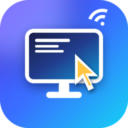

# remotedesktop

SwiftPM で作ったリモートデスクトップです。**iPad（または Mac）から Windows の画面を見て操作**します。
通信はすべて**端末間で暗号化・相互認証**され、**ペアリングした端末だけ**が接続できます。外出先からは**ポート開放なしの中継サーバー経由**で使えます。

| | 動かす場所 | 役割 |
|---|---|---|
| `RDHost.exe` | **Windows**（操作される側） | 画面キャプチャを配信し、受け取った入力を注入 |
| `ipad/RemoteDesktop.swiftpm` | **iPad / iPhone**（操作する側） | Swift Playgrounds で開くアプリ |
| `RDViewer` | **macOS**（操作する側） | Mac 用ビューア |
| `relay/` | **無料の Render など** | 外出先用の中継サーバー（暗号文を受け渡すだけ） |

## セキュリティの概要（詳細は [SECURITY.md](SECURITY.md)、検査する人向けは [REVIEW.md](REVIEW.md)）

- **Noise Protocol（`Noise_XX_25519_ChaChaPoly_SHA256`）**で暗号化と相互認証。平文モードなし。対応端末では**耐量子暗号 ML-KEM-768** も併用し、長いセッションでは定期的に鍵を更新。
- **パスワードなし。** 端末ごとの鍵で認証し、ホストは登録済みの端末だけを受け入れます。
- **ペアリングコード**にホストの指紋が入っているので、初回でもなりすましを自動で検出。コードは 1 回限り・10 分で失効・5 回間違えると無効。**登録は同じ Wi-Fi からだけ、かつ Windows の画面での許可が必須**。
- **iPad の鍵は Secure Enclave で守り、接続のたびに Face ID**。なくした iPad からは接続できません。
- **中継サーバーは中身を読めません。** ホストは外向きに接続するだけなので、自宅のルーターで**ポートを開ける必要がありません**。
- Windows の秘密鍵は TPM + DPAPI で保護。許可端末の一覧は改ざん検知つき、監査ログはハッシュチェーン（Windows イベントログにも記録）。総当たり対策、端末の失効（接続中も即切断）。
- 接続中は Windows の画面上部に赤い帯を表示。無操作 15 分で切断、切断後はモニター消灯。管理者権限では起動しない。
- 配布する EXE には GitHub の**出どころ証明**と SHA-256 を付け、解析部分は継続的にファジング。

> 第三者のセキュリティ監査は受けていません。限界は SECURITY.md の「既知の限界」を見てください。

## 使い方

### 1. 中継サーバー（外出先から使う場合・最初に一度だけ）

[Render](https://render.com) の無料プランで動かします。このリポジトリの `render.yaml`（Blueprint）からデプロイすると `https://<名前>.onrender.com` が中継サーバーの URL になります。

### 2. Windows 側 (RDHost.exe)

GitHub Actions の `build` ワークフローの成果物 **`RDHost-windows-x64`** をダウンロードし、フォルダごと置きます（自分でビルドする場合は `scripts\build-windows.ps1`）。

ダウンロードしたものが GitHub Actions で作られた本物か確かめるには（[GitHub CLI](https://cli.github.com/) が必要）:

```bash
gh attestation verify RDHost.exe -R prak59459-create/remotedesktop
```

**通常のユーザー（管理者ではない）で起動してください。**

**初回**は、iPad と同じ Wi-Fi で `--pair` 付きで起動します:

```bash
RDHost.exe --pair --relay https://<名前>.onrender.com
```

表示された**ペアリングコード**を iPad に入力します（PC は iPad の「この Wi-Fi で見つかった PC」に名前で出ます。出ないときは画面に表示される IP アドレスを入力）。2 回目以降は `--pair` なしで起動します:

```bash
RDHost.exe --relay https://<名前>.onrender.com --confirm
```

| オプション | 説明 |
|---|---|
| `--pair` | 新しい端末を登録するためのコードを表示（同じ Wi-Fi からのみ。登録時は画面で許可） |
| `--relay URL` | 中継サーバー経由でも待ち受ける（ポート開放不要） |
| `--relay-transport auto/websocket/http` | 中継サーバーへの通り道（既定 auto: WebSocket がつながらなければ普通の HTTP に自動で切り替え）。WebSocket を通さない会社のプロキシなどでは `http` |
| `--no-direct` | 直接接続（TCP 5999）の待ち受けをしない |
| `--no-bonjour` | 同じ Wi-Fi の iPad に PC の名前を知らせない（IP アドレスで接続） |
| `--confirm` | 登録済みの端末でも、接続のたびに Windows 側で許可/拒否のダイアログを出す（外出先で使うなら付けない） |
| `--on-disconnect blank/lock/none` | 最後の接続が切れたときの画面（既定: モニター消灯） |
| `--idle-timeout 分` / `--max-session 時間` | 無操作で切断するまでの時間（既定 15 分）/ 最長時間（既定 8 時間） |
| `--require-pq` | 耐量子暗号に対応していない端末（iPadOS 26 未満）を拒否 |
| `--bind ADDR` / `--port N` / `--fps N` / `--scale N` | 待ち受けアドレス、ポート、最大フレームレート、縮小率 |
| `--max-kbps N` | 画面データの送信量の上限（kbps、既定は無制限）。無料の中継サーバーの月間転送量を守りたいとき（例: `500`） |
| `--list` / `--revoke ID` / `--fingerprint` | 登録済み端末の一覧 / 取り消し / ホストの指紋 |
| `--verify-log` / `--reset-devices` | 監査ログの改ざん検証 / 登録端末をすべて消去（一覧の改ざんを検知したとき） |
| `--allow-remote-pairing` | LAN 外からの端末登録も許可（非推奨） |

ポート開放は**不要**です（中継モード）。直接接続をインターネットに公開したい場合でも、ペアリングは LAN 内からしか受け付けません。

### 3. iPad 側

1. このリポジトリの `ipad/RemoteDesktop.swiftpm` フォルダを iPad の「ファイル」に入れ（iCloud Drive など）、**Swift Playgrounds** で開いて実行します。
2. **初回**: 「同じ Wi-Fi」を選び、「この Wi-Fi で見つかった PC」から PC を選んで（または IP アドレスを入力して）、ペアリングコードを入力して「接続」。Windows 側に出る確認ダイアログで「はい」を押し、iPad に表示されたホストの指紋が Windows 側の表示と同じか確認します。
3. **外出先**: 「外出先 (中継)」を選び、中継サーバーの URL を入力して「接続」。中継の設定（部屋 ID）は初回の接続で自動的に受け取ってあります。WebSocket が使えないネットワーク（会社や公衆 Wi-Fi のプロキシなど）では、自動で普通の HTTP 通信に切り替えてつなぎます（「通り道」で「HTTP」に固定することもできます）。
4. 接続のたびに Face ID を求められます（Face ID を登録し直したら、もう一度ペアリングが必要です）。

<p align="center"></p>

iPad アプリの機能:
- **接続画面:** ペアリング済みの PC と最後の接続日時、同じ Wi-Fi で見つかった PC の一覧、接続方法の選択。
- **設定:** ポインタとスクロールの速さ、ナチュラルスクロール、触覚フィードバック、通信状況の表示、なめらか表示、⌘ を Ctrl として送るか。
- **接続中のツールバー:** すりガラス調で、たたんで小さくできます。次のボタンがあります。
  - キーボード・文字入力
  - **特殊キー**: Ctrl・Alt・Shift・Win を次のキーやクリックに付ける。Esc・Tab・矢印・F1〜F12・Home/End・PgUp/PgDn・半角/全角など
  - **ショートカット**: コピー、貼り付け、アプリの切り替え、タスクマネージャー、画面の切り取りなど
  - **クリップボードの送信**: iPad でコピーした文字を Windows に入力
  - **スクリーンショット**: 今の画面を保存・共有
  - **通信状況**: fps・受信量・合計
  - 等倍に戻す・操作方法・設定・切断
- アイコンは `scripts/make-icons.py` で描いています。色や形を変えるときは、このスクリプトを直して作り直してください。

操作（トラックパッド方式。接続中のツールバーの 👆 ボタンでも見られます）:
- 1 本指でなぞる: カーソル移動 / 1 本指タップ: 左クリック（2 回でダブルクリック）
- 2 本指タップ: 右クリック / 3 本指タップ: 中クリック
- 2 本指で動かす: スクロール / 長押ししてから動かす: ドラッグ
- ピンチ: 表示の拡大・縮小（拡大中はカーソルを追って表示が動く。ツールバーのボタンで等倍に戻す）
- マウスやトラックパッドを iPad につないだ場合: ポインタの位置がカーソルになり、左右のクリック・ドラッグ・ホイールが使える
- ハードウェアキーボードはそのまま使えます（⌘ は Ctrl として送る設定が既定）。⌨️ で画面キーボード、文字入力ボタンで日本語などを確定してまとめて送れます

### 4. Mac 側（任意）

```bash
swift run -c release RDViewer
```

## 仕組み

```
Sources/
  RDCore/
    Security/  Noise XX、暗号化ストリーム、ペアリング、認証、鍵の保管 (DPAPI / キーチェーン)
    Relay / WebSocket / Transport   中継経由の接続 (URLSession / WinHTTP / 最小実装)
    HTTPRelay / HTTPClient          WebSocket を使わず HTTP リクエストだけで中継する通り道
    ...        メッセージ、ソケット (Winsock / BSD)、タイル差分コーデック
  RDHost/      Windows: GDI キャプチャ + SendInput + 承認ダイアログ（Windows 以外ではテストパターン配信）
  RDViewer/    macOS: AppKit ビューア（--headless で GUI なしの受信テスト）
ipad/RemoteDesktop.swiftpm/
  App/         iPad アプリ (SwiftUI + UIKit)
  Core/        Sources/RDCore のコピー (scripts/sync-ipad.sh で更新。直接編集しない)
relay/         中継サーバー (Node.js + ws。WebSocket と HTTP の両方を受け付ける)
```

- 画面を 64×64 のタイルに分け、変化したタイルだけを RLE（24bit 色）で送ります。
- ビューアがフレームを処理し終えたら ACK を返し、ホストはそれを待ってから次を送るので、遅い回線でも遅延が溜まりません。

### 動作確認（Windows / Mac がなくても）

Windows 以外で `RDHost` を動かすとテストパターンを配信し、受け取った入力をログに出します。

```bash
swift run -c release RDHost --port 6001 --pair
```

```bash
swift run -c release RDViewer --headless 127.0.0.1 6001 --pair <表示されたコード> --frames 90
```

```bash
swift test
```

中継経由も試す場合:

```bash
cd relay && npm ci && PORT=8099 node server.js
```

```bash
swift run -c release RDHost --port 6001 --pair --relay ws://127.0.0.1:8099
```

（ペアリングは直接接続で行い、その後 `RDViewer --headless --relay ws://127.0.0.1:8099 --frames 90` で中継経由になります。HTTP の通り道を試すときは RDHost と RDViewer の両方に `--relay-transport http` を付けます）

## 制限

- プライマリモニタのみ。音声・クリップボード共有・ファイル転送なし。
- ロック画面や UAC の確認画面は（Windows の仕様上）キャプチャ・操作できません。Ctrl+Alt+Del も送れません。
- 通信量を減らす仕組み:
  - 画面が変わらない間は何も送りません。マウスカーソルは画面の画像に描き込まず、iPad 側で描いています。
  - 文字や UI のタイルは、少ない色のパレットで可逆に圧縮します。
  - スクロールやウィンドウの移動、動画など**動いている間は、縦横 1/2・16bit 色の粗い画質**で送ります。**止まって 0.3 秒たつと、その部分だけを 1 回、元の画質で送り直します。**
  - 打った文字のような小さな変化は、最初から元の画質で送ります。
- RDHost の画面には 60 秒ごとに通信量（平均 kbps と、粗く送ったタイル・送り直したタイルの数）が出ます。セッションの終わりには合計も出ます。
- 無料の中継サーバー（Render）は、送信が月 5GB までです。動画など動きの多い画面は多く使うので、`--max-kbps`・`--scale 2`・`--fps 15` で抑えてください。
- iPad アプリは Swift Playgrounds での実行を想定しています（App Store 配布はしていません）。
